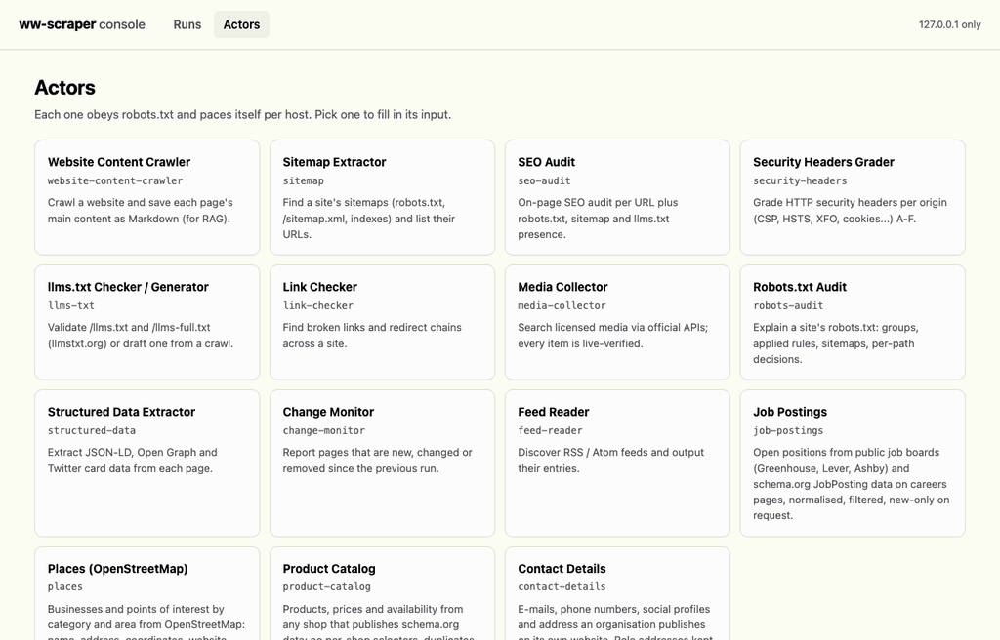
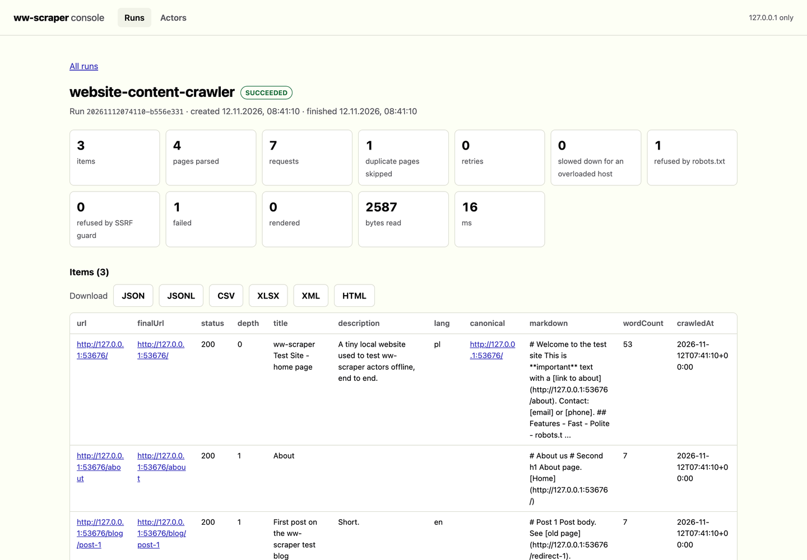

# ww-scraper

<picture>
  <source media="(prefers-color-scheme: dark)" srcset="docs/how-it-works-dark.svg">
  
</picture>
<p align="center"><a href="docs/system-map.md">Full system map: 12 diagrams</a></p>

Use it when you need job postings from company job boards, businesses from OpenStreetMap,
products and prices from shops, contact details, a crawl for RAG, or an SEO and security-header
audit, on your own machine, without proxies, evasion or anything a site has not allowed.

<p align="center"></p>

Each release on GitHub carries a wheel and a source archive
([v0.9.0](https://github.com/WWIntegrations/ww-scraper/releases/tag/v0.9.0)); download the
wheel, check it, then install it with pip.

ww-scraper is a compliant, open-source local mirror of the useful primitives of commercial scraping
platforms (datasets, key-value stores, request queues, actors, runs and a
small HTTP API), plus seventeen ready actors, including job postings, places, product catalogs, contact details and the original licensed media collector.
Everything runs on your machine, in the open, strictly inside what each site permits:
robots.txt always, a per-host rate limit, an honest User-Agent with a contact, and
personal data redacted by default.

## Quickstart

Offline, against the bundled test site (needs Python 3.10+; the `--allow-loopback` switch is
for tests only, by default 127.0.0.1 and every private address are refused):

```bash
git clone https://github.com/WWIntegrations/ww-scraper && cd ww-scraper
python3 -m venv .venv && . .venv/bin/activate && pip install -e .
ww-scraper testsite --port 8766 &
ww-scraper run seo-audit --allow-loopback --storage /tmp/ww-scraper-demo \
  --input '{"startUrls": ["http://127.0.0.1:8766/"], "minIntervalSecs": 0}'
```

Real output (exit code 0): the last lines are the run record, with `"status": "SUCCEEDED"`
and `"itemCount": 6`; the items land in `/tmp/ww-scraper-demo/datasets/<run-id>/items.jsonl`.
The test site's `/private/secret` is disallowed by its `robots.txt`, so ww-scraper logs
`robots: disallowed by robots.txt` and does not fetch it.

## Principles (what makes ww-scraper different)

- **Official APIs or robots-allowed pages only.** Each source is an official API, or a
  public page explicitly allowed by its `robots.txt`, re-checked on every run.
- **No evasion, ever.** ww-scraper never uses residential/rotating proxies, never rotates
  identities to dodge rate limits, never solves CAPTCHAs, never bypasses anti-bot
  measures. A source that asks automated clients to stay out (e.g. HTTP 403 "automated
  access blocked") is *skipped*, not worked around.
- **Live verification.** Every returned asset is fetched and checked: HTTP 200, a real
  `image/*` content-type, real decoded dimensions, a byte cap, and a decompression-bomb
  guard. No dead links.
- **Provenance + license on every item.** Author, license, license URL and source page
  travel with each result. Untrusted text is sanitized; URLs are restricted to http(s).
- **SSRF-safe.** Asset fetches follow a per-source host allowlist, every redirect hop is
  re-checked, and private / loopback / link-local addresses are refused.
- **No secrets in the repo.** API keys (e.g. `PEXELS_API_KEY`) are read from the
  environment only.

See [`COMPLIANCE.md`](COMPLIANCE.md) for how each risk criterion - data type (GDPR),
copyright, ToS / robots.txt, server load, and no-evasion - maps to ww-scraper's behavior.

## What you can do with it

```bash
ww-scraper actors                                     # the seventeen built-in actors
ww-scraper run seo-audit --input '{"startUrls": ["https://example.com/"]}'
ww-scraper run website-content-crawler --input '{"startUrls": ["https://example.com/"], "render": true, "maxConcurrency": 4}'
ww-scraper runs                                       # what ran, with status, item counts and status message
ww-scraper report <run-id>                            # one HTML file you can open or send
ww-scraper purge --older-than 30d --dry-run           # what old runs would be deleted
ww-scraper task save py-jobs job-postings --input '{"boards": ["lever:<company>"], "keywords": ["python"]}'
ww-scraper task run py-jobs                           # the saved input, by name
ww-scraper init price-watch                           # your own actor in one Python file
ww-scraper run ./price_watch.py --input '{"startUrls": ["https://example.com/"]}'
ww-scraper serve                                      # local HTTP API, token required
```

| Need | How |
|---|---|
| Pages that build their content with JavaScript | `"render": true` re-reads each page through a local headless Chrome; the browser's connections go through a proxy that refuses private addresses |
| Faster crawls over several hosts | `"maxConcurrency": N` (1 to 16); one host is still never asked more often than `minIntervalSecs` |
| A scraper for one specific site | `ww-scraper init <name>` writes a working actor; edit `run(ctx)` |
| A result to hand to someone | `ww-scraper report <run-id>`, or `ww-scraper export <id> --format xlsx --out items.xlsx` |
| Know why a URL was skipped | `robots-audit` shows the group, the rule and the pattern that decided |
| Watch a site for changes | `change-monitor` with a `monitorName`, on a schedule printed by `ww-scraper schedule` |
| One list built from many runs | `--dataset weekly-jobs` on each run appends its items to the named dataset `weekly-jobs` |
| Keep the disk from filling | `ww-scraper purge --older-than 30d` deletes old runs and their unnamed storages; named storages stay; `--dry-run` first |
| A run that must not cost more than planned | `--max-items N`, `--max-requests N`, `--max-bytes N`: the run stops cleanly and SUCCEEDS with what it has |
| A run that must not hang | `--timeout SECS` (or `"timeoutSecs"` in the input): the run ends TIMED-OUT and keeps what it stored |

How this compares with a hosted platform, including what it does not do:
[docs/comparison.md](docs/comparison.md). The decisions behind it and the defects found on the
way: [docs/case-study.md](docs/case-study.md).

Measured against Crawlee, a widely used open-source crawler library, on one hostile local site
([bench/safety](bench/safety/README.md)): in default configuration Crawlee fetched a page
robots.txt disallows, tried to connect to the cloud metadata address after a redirect,
retried a 429 within 10 ms of `Retry-After: 4`, and exported a scraped formula live into
CSV. ww-scraper did none of the four.

On a generated 500-page site where every page is also linked as a print view, with tracking
parameters, with a trailing slash and through an old redirecting path
([bench/crawl](bench/crawl/README.md)), with the same budget for both (10 requests in flight):
ww-scraper downloaded 510 pages and handed over 0 duplicates in 1.6 s and 35 MB; Crawlee
downloaded 2,500 pages, handed over 2,000 duplicates, followed links from a `nofollow` page,
and took 8.3 s and 389 MB. ww-scraper learns from each site's `rel=canonical` which URL
variants are the same page.

## Platform primitives

Stored under `./storage/` (or `$WW_SCRAPER_STORAGE_DIR`), laid out as:

| Primitive      | What it is                                                              |
|----------------|-------------------------------------------------------------------------|
| `Dataset`      | append-only JSONL; export as `json`, `jsonl`, `csv`, `xlsx`, `xml`, `html` or `rss`, with `fields` to pick and order columns, `omit`, `flatten`, `unwind`, `desc` and `clean` (formulas never evaluated) |
| `KeyValueStore`| named files with their content-type (`INPUT`, `OUTPUT`, `llms.txt`...)   |
| `RequestQueue` | durable, deduplicated by `unique_key`, resumable after a crash; `forefront` adds and `add_many` batches |
| Actor schemas  | `output_schema` (named result links in the run record), `dataset_schema` (every item checked on push, named export views), `kv_schema` (key collections with content types), `version` |
| `Actor`        | name + `input_schema` (validated: types, ranges, `pattern`, `errorMessage`; errors in English or Polish; form hints `prefill`, `sectionCaption`, `editor`; `secret` fields never stored) + `run(ctx)` |
| `RunContext`   | input, dataset, kv, queue, log, polite session, statistics, `use_state()` (saved every 60 s and at the end, back on resume); `ctx.dataset("name")`, `ctx.kv("name")`, `ctx.queue("name")` open named storages |
| Named storage  | a storage opened by name: shared by every run that uses the name, kept by `purge`; `--dataset NAME` appends a run's items to one |
| Run record     | `storage/runs/<id>.json`: READY / RUNNING / ABORTING / TIMING-OUT / SUCCEEDED / FAILED / ABORTED / TIMED-OUT, times, counters, live status message |

`PoliteCrawler` is the only way actors fetch pages: robots.txt per origin (RFC 9309, cached, with
Crawl-delay), a minimum interval per host, retries with backoff on 429/5xx that honour
`Retry-After` (and give up if asked to wait longer than the cap), adaptive pacing (a 429
or 503 doubles that host's interval for the rest of the run, ten clean answers in a row
ease it back by a quarter, never below the interval or Crawl-delay), `max_pages` /
`max_depth`, same-origin scope with include/exclude globs, the SSRF guard on every
redirect hop, a content-type filter and a byte limit. HTML is turned into Markdown and
metadata with the standard library only (`html.parser`).

## Actors

| Actor                     | Output                                                              |
|---------------------------|---------------------------------------------------------------------|
| `website-content-crawler` | main content of each page as Markdown (for RAG); noindex pages skipped |
| `sitemap`                 | URLs from robots.txt `Sitemap:`, `/sitemap.xml`, indexes, `.xml.gz`, text sitemaps |
| `seo-audit`               | per page: status, title/description length, h1 count, canonical, robots, hreflang, OG, JSON-LD, image alt; per site: robots.txt, sitemap, `/llms.txt` |
| `security-headers`        | per origin: CSP, HSTS, XFO / frame-ancestors, XCTO, Referrer-Policy, Permissions-Policy, COOP/CORP, cookie flags; grade A-F with reasons |
| `llms-txt`                | checks `/llms.txt` + `/llms-full.txt` against llmstxt.org, or drafts one (`"mode": "generate"`) |
| `link-checker`            | broken links (internal and external) and redirect chains            |
| `media-collector`         | the v0.1 sources below, as an actor                                 |
| `robots-audit`            | per origin: robots.txt groups, the group that applies to each crawler, Crawl-delay, sitemaps, and the decision with the winning rule for every test path; fetches nothing but robots.txt |
| `structured-data`         | per page: JSON-LD objects (lifted out of `@graph`), Open Graph and Twitter card tags, invalid JSON-LD blocks |
| `change-monitor`          | pages that are new, changed or removed (404/410) since the previous run with the same `monitorName`; pages seen before are asked for with ETag / Last-Modified, so an unchanged page that answers 304 is not downloaded again; the snapshot keeps hashes, titles, word counts, validators and link URLs, not page text |
| `feed-reader`             | RSS / Atom feeds a page advertises (or feed URLs given directly) and their entries |
| `job-postings`            | open positions from the public Greenhouse and Lever job-board APIs, Ashby board pages and schema.org `JobPosting` data on any careers page: title, company, location, remote, salary, department, posted date, apply link; keyword, location and remote filters; `watchName` returns only postings new since the last run |
| `places`                  | businesses by category (32 ready ones) or raw OSM tags, in a city, a radius or a box, from OpenStreetMap via public Overpass instances that allow API use (with fallback): address, coordinates, website, phone, opening hours, with the ODbL attribution in every record |
| `product-catalog`         | products from any shop's schema.org data (Product, ProductGroup variants, AggregateOffer, Open Graph fallback): price, currency, availability, GTIN, SKU, brand, rating; duplicates removed by GTIN or SKU; records a merchant feed would reject are flagged |
| `contact-details`         | the e-mails, phones, social profiles, address and VAT id a company publishes on its home, contact, about and imprint pages; role addresses (info@, biuro@) kept, personal ones masked unless `redactPii` is off |
| `lead-list`               | `places` then `contact-details` on every place with a website, joined into one record per business: name, category, address, website, role e-mails and phones, social profiles, source (OSM link, ODbL attribution, pages read); the masking of both actors is kept |
| `pipeline`                | actors run one after another, a field of one step's items (e.g. `url`) becoming the start URLs of the next, e.g. `sitemap` then `seo-audit` |

```bash
ww-scraper actors                                   # list actors and input fields
ww-scraper run seo-audit --input '{"startUrls": ["https://example.com/"], "maxPages": 10}'
ww-scraper run website-content-crawler --input-file input.json --print-items
ww-scraper run sitemap --resume <run-id>            # continue an interrupted run
ww-scraper export <dataset-id> --format csv
ww-scraper export <dataset-id> --format xlsx --fields url,title --out items.xlsx
ww-scraper export <dataset-id> --format csv --flatten --unwind emails --omit pagesRead
ww-scraper export <dataset-id> --format rss --desc > feed.xml   # new postings in a feed reader
ww-scraper run robots-audit --input '{"startUrls": ["https://example.com/"], "testPaths": ["/", "/admin"]}'
ww-scraper run change-monitor --input '{"startUrls": ["https://example.com/"], "monitorName": "example"}'
```

### Ready scrapers, without the grey zone

The four newest actors cover the categories people most often buy ready-made scrapers for,
built so they never need to break a rule to work:

- **Jobs** read the job-board APIs companies publish for embedding their openings, not
  aggregator sites that forbid scraping. One normalised format across three ATS vendors and
  any careers page with Google for Jobs markup.
- **Places** read OpenStreetMap, open data you may republish, instead of a map service whose
  terms forbid extraction. The main Overpass server disallows `/api/` in robots.txt, so the
  default endpoint is a public instance that does not; any instance can be configured.
- **Products** read the structured data shops publish for search engines, so there are no
  CSS selectors to maintain and a redesign does not break the scraper.
- **Contacts** apply a GDPR rule per field instead of all or nothing: an address that names a
  function is business contact data; an address that names a person is masked by default.

```bash
ww-scraper run job-postings --input '{"boards": ["greenhouse:<board>", "lever:<company>", "ashby:<org>"], "keywords": ["python"], "remoteOnly": true, "watchName": "my-search"}'
ww-scraper run places --input '{"category": "dentist", "city": "Gdańsk"}'
ww-scraper run product-catalog --input '{"startUrls": ["https://shop.example/"], "maxPages": 500}'
ww-scraper run contact-details --input '{"startUrls": ["https://company.example/"]}'
ww-scraper run lead-list --input '{"category": "dentist", "city": "Gdańsk", "maxResults": 100}'
```

`lead-list` is built from the other two with `ctx.call_actor()`: an actor can run another
actor in the same process and get its run record back. The called run has its own storages,
never outlives the caller's timeout and stops when the caller is aborted. The `pipeline`
actor does the same from JSON:

```bash
ww-scraper run pipeline --input '{"steps": [
  {"actor": "sitemap", "input": {"startUrls": ["https://example.com/"]}},
  {"actor": "seo-audit", "input": {"maxPages": 50}, "urlsFrom": "url"}]}'
```

Try it offline against the bundled test site (the `--allow-loopback` switch is for
tests only; by default 127.0.0.1 and every private address are refused):

```bash
ww-scraper testsite --port 8766 &
ww-scraper run seo-audit --allow-loopback --storage /tmp/ww-scraper-demo \
  --input '{"startUrls": ["http://127.0.0.1:8766/"], "minIntervalSecs": 0}'
```

Python:

```python
from ww_scraper import run_actor
rec = run_actor("link-checker", {"startUrls": ["https://example.com/"]})
print(rec["status"], rec["itemCount"], rec["defaultDatasetId"])
```

### Local API

```bash
ww-scraper serve --port 8765               # binds to 127.0.0.1 only
# a Bearer token is always required: --token / $WW_SCRAPER_API_TOKEN, otherwise a random
# one is generated and printed once at start; --no-auth disables it explicitly
```

| Route | |
|---|---|
| `GET /v2/acts` | list actors with input schemas |
| `POST /v2/acts/<name>/runs?waitForFinish=60&timeout=300` | start a run, body = input JSON |
| `GET /v2/actor-runs/<id>` | run record (`POST .../abort` to stop, `POST .../resurrect` to run a finished one again) |
| `GET /v2/datasets/<id>/items?format=json\|jsonl\|csv\|xlsx\|xml\|html\|rss&fields=a,b&omit=c&flatten=1&unwind=d&desc=1&clean=1` | items (HTML served with `CSP: sandbox`) |
| `GET /v2/key-value-stores/<id>/records/<key>` | a record with its content-type |
| `GET /v2/actor-runs/<id>/log` | the last 256 KB of the run log |
| `POST /v2/acts/<name>/run-sync-get-dataset-items` | run, wait (up to 300 s) and return the items; takes the export options |
| `POST /v2/acts/<name>/run-sync` | run, wait and return the `OUTPUT` record |
| `GET /v2/datasets`, `/v2/key-value-stores`, `/v2/request-queues` (`?named=1`) | list storages; `GET` or `DELETE .../<id>` for one |
| `GET /v2/key-value-stores/<id>/keys?collection=` | record keys; `PUT` / `DELETE .../records/<key>` writes or removes one |
| `GET /v2/request-queues/<id>/requests`, `.../head` | queued requests, the next pending ones |
| `GET /v2/actor-tasks`, `POST /v2/actor-tasks/<name>/runs` | tasks; `POST /v2/actor-tasks` saves one |
| `GET /v2/stats/runs?days=30&last=200` | runs per day and status, metrics of recent runs |
| `GET /v2/openapi.json` | this API as OpenAPI 3.1 (also [`docs/openapi.json`](docs/openapi.json)) |
| `GET /console` | the web console below |

### Console

`ww-scraper serve` also prints a console link (`http://127.0.0.1:8765/console#token=...`).
In the browser you can start any actor from a form built from its input schema, watch a
run's counters and log while it runs, abort it, page through its items and download them
in any export format.

<picture>
  <source media="(prefers-color-scheme: dark)" srcset="docs/console-run-dark.png">
  
</picture>

- The token travels in the URL fragment, which browsers never send to a server, and is
  kept in that tab's `sessionStorage` only. The page, its script and its stylesheet hold no
  data and are served without the token; every value comes from the `/v2` routes, which
  still need it.
- Content-Security-Policy `default-src 'none'; script-src 'self'; connect-src 'self';
  frame-ancestors 'none'`: no inline script, no third-party code, no framing.
- Scraped values are written as text, never parsed as HTML; only plain `http(s)` values
  become links. A headless-Chrome test loads a run whose item title is an
  `` and a `<script>` and checks that both stay text.
- No build step and no dependencies: three static files in `ww_scraper/console/`.

Requests with a non-loopback `Host` header (DNS-rebinding guard) or a non-loopback
`Origin` header (browser CSRF guard) get 403; POST bodies must be `application/json`
(415 otherwise).

### Webhooks

After a run, ww-scraper can POST `ACTOR.RUN.SUCCEEDED|FAILED|ABORTED|TIMED_OUT` events
(and, for webhooks that list them in `eventTypes`, `ACTOR.RUN.CREATED|RESURRECTED` when a run
starts) (CLI
`--webhook URL`, or the API `webhooks` query parameter as base64 JSON
`[{"requestUrl": ..., "eventTypes": [...]}]`). Only hosts in `WW_SCRAPER_WEBHOOK_HOSTS`
(comma separated) are contacted, over HTTPS, without following redirects, and only
when `WW_SCRAPER_WEBHOOK_SECRET` is set. Each request carries `X-WW-Scraper-Timestamp` and
`X-WW-Scraper-Signature: sha256=HMAC_SHA256(secret, "<timestamp>." + body)`;
`ww_scraper.webhooks.verify()` checks it on the receiving side.

### Scheduling

`ww-scraper schedule <actor> --cron '0 6 * * 1' --input '<json>'` only **prints** a crontab
line and a launchd plist. Installing them is the operator's decision.
`ww-scraper schedule --task py-jobs --cron @daily` schedules a saved task instead; the macros
`@hourly`, `@daily`, `@weekly`, `@monthly` and `@yearly` work in both. Times are the machine's
local time; `--tz Europe/Warsaw` adds a `CRON_TZ` line for cron daemons that read it.

### Tasks

A task is a saved input (and run options such as `timeoutSecs` or `datasetName`) for one
actor, stored in `storage/tasks/<name>.json`:

```bash
ww-scraper task save py-jobs job-postings --input '{"boards": ["lever:<company>"]}' --timeout 600
ww-scraper task list
ww-scraper task run py-jobs --input '{"remoteOnly": true}'   # merged over the saved input
ww-scraper task delete py-jobs
```

## Media sources (v0.1)

| Source     | Access                              | License info       |
|------------|-------------------------------------|--------------------|
| Openverse  | `api.openverse.org` (anonymous)     | yes (CC / PDM)     |
| Wikimedia  | Commons MediaWiki API               | yes (per-file)     |
| Pexels     | `api.pexels.com` (`PEXELS_API_KEY`) | Pexels License     |
| Met Museum | Open Access API (anonymous)         | CC0 (public domain)|

Every adapter implements the same `Source` contract and declares the hosts its assets
may live on (the SSRF allowlist used during verification). New sources are added only
after they pass the compliance checklist above. Pexels needs `PEXELS_API_KEY` in the
environment; without it that source simply yields nothing.

## Install

```bash
pip install -e .
# core needs only the standard library + requests; Pillow is used by media verification
```

## Usage

```python
from ww_scraper import search

for r in search("brutalist concrete architecture", sources=["openverse"], limit=12):
    print(r.title, "-", r.author, f"({r.license})", r.url, f"{r.width}x{r.height}")
```

CLI:

```bash
python3 -m ww_scraper "brutalist concrete architecture" --sources openverse --limit 12 --json
```

Set a contact for the User-Agent (polite crawling):

```bash
export WW_SCRAPER_CONTACT="https://github.com/<you>/ww-scraper"
```

## Limitations

### What ww-scraper deliberately does NOT do

Residential/rotating proxies, identity rotation to defeat rate limits, CAPTCHA solving,
headless-browser anti-bot evasion, ignoring robots.txt (there is no switch for it),
collecting from sources that forbid automated access, multi-tenant hosting, or
scraping on behalf of an MCP/agent tool. These are out of scope **by design**: the point is a collector you can run in
the open, that respects the sites it touches.

### Known limits

- robots.txt follows RFC 9309 (`ww_scraper/robots.py`): `*` and `$` in paths, longest match
  wins, `Allow` wins a tie, a group naming `ww-scraper` replaces the `*` group. A group is
  selected by exact product token, not by substring. `%2F` in a path is compared as `/`.
- `change-monitor` compares the extracted main content, so a change only in navigation,
  footer or scripts is not reported.
- `feed-reader` reads RSS 2.0, RDF and Atom titles, links, ids, dates and summaries; it
  does not read enclosures or JSON Feed.
- DNS rebinding is closed for crawler, robots.txt and webhook requests: the host is
  resolved once at connect time, every address is validated, the socket goes to that
  IP (Host/SNI unchanged) and the peer is re-checked, on every redirect hop. Those
  sessions ignore `HTTP(S)_PROXY`, because a proxy would resolve names itself. The
  v0.1 media verification still uses its per-source host allowlist instead.
- Sitemaps are read by a single linear pass over tag boundaries (no XML parser), so
  unusual but valid XML constructs beyond the sitemap vocabulary are ignored.
- PII redaction is a heuristic for e-mail addresses and phone numbers, not a full
  personal-data classifier.
- JavaScript rendering needs Chrome or Chromium on the machine (`WW_SCRAPER_CHROME` points
  at a specific binary). The page's own sub-requests are made by the browser like any
  visitor's browser; they are blocked from private addresses but not checked against
  robots.txt one by one. Rendering visits each page twice (once to check, once to render).
- Concurrency never shortens the interval to a single host, so a one-site crawl is not
  faster with `maxConcurrency`.
- File actors are ordinary Python run with your permissions: run only files you trust.

## License

MIT. See [`LICENSE`](LICENSE).
