# ww-scraper

<picture>
  <source media="(prefers-color-scheme: dark)" srcset="docs/how-it-works-dark.svg">
  
</picture>
<p align="center"><a href="docs/system-map.md">Full system map: 12 diagrams</a></p>

Use it when you need to crawl sites, audit SEO and security headers, or collect licensed
images on your own machine, without proxies, evasion or anything a site has not allowed.

ww-scraper is a compliant, open-source local mirror of the useful primitives of commercial scraping
platforms (Apify-style datasets, key-value stores, request queues, actors, runs and a
small HTTP API), plus eleven ready actors, including the original licensed media collector.
Everything runs on your machine, in the open, strictly inside what each site permits:
robots.txt always, a per-host rate limit, an honest User-Agent with a contact, and
personal data redacted by default.

## Quickstart

Offline, against the bundled test site (needs Python 3.10+; the `--allow-loopback` switch is
for tests only, by default 127.0.0.1 and every private address are refused):

```bash
git clone https://github.com/WWIntegrations/ww-scraper && cd ww-scraper
python3 -m venv .venv && . .venv/bin/activate && pip install -e .
ww-scraper testsite --port 8766 &
ww-scraper run seo-audit --allow-loopback --storage /tmp/ww-scraper-demo \
  --input '{"startUrls": ["http://127.0.0.1:8766/"], "minIntervalSecs": 0}'
```

Real output (exit code 0): the last lines are the run record, with `"status": "SUCCEEDED"`
and `"itemCount": 6`; the items land in `/tmp/ww-scraper-demo/datasets/<run-id>/items.jsonl`.
The test site's `/private/secret` is disallowed by its `robots.txt`, so ww-scraper logs
`robots: disallowed by robots.txt` and does not fetch it.

## Principles (what makes ww-scraper different)

- **Official APIs or robots-allowed pages only.** Each source is an official API, or a
  public page explicitly allowed by its `robots.txt`, re-checked on every run.
- **No evasion, ever.** ww-scraper never uses residential/rotating proxies, never rotates
  identities to dodge rate limits, never solves CAPTCHAs, never bypasses anti-bot
  measures. A source that asks automated clients to stay out (e.g. HTTP 403 "automated
  access blocked") is *skipped*, not worked around.
- **Live verification.** Every returned asset is fetched and checked: HTTP 200, a real
  `image/*` content-type, real decoded dimensions, a byte cap, and a decompression-bomb
  guard. No dead links.
- **Provenance + license on every item.** Author, license, license URL and source page
  travel with each result. Untrusted text is sanitized; URLs are restricted to http(s).
- **SSRF-safe.** Asset fetches follow a per-source host allowlist, every redirect hop is
  re-checked, and private / loopback / link-local addresses are refused.
- **No secrets in the repo.** API keys (e.g. `PEXELS_API_KEY`) are read from the
  environment only.

See [`COMPLIANCE.md`](COMPLIANCE.md) for how each risk criterion - data type (GDPR),
copyright, ToS / robots.txt, server load, and no-evasion - maps to ww-scraper's behavior.

## What you can do with it

```bash
ww-scraper actors                                     # the eleven built-in actors
ww-scraper run seo-audit --input '{"startUrls": ["https://example.com/"]}'
ww-scraper run website-content-crawler --input '{"startUrls": ["https://example.com/"], "render": true, "maxConcurrency": 4}'
ww-scraper runs                                       # what ran, with status and item counts
ww-scraper report <run-id>                            # one HTML file you can open or send
ww-scraper init price-watch                           # your own actor in one Python file
ww-scraper run ./price_watch.py --input '{"startUrls": ["https://example.com/"]}'
ww-scraper serve                                      # local HTTP API, token required
```

| Need | How |
|---|---|
| Pages that build their content with JavaScript | `"render": true` re-reads each page through a local headless Chrome; the browser's connections go through a proxy that refuses private addresses |
| Faster crawls over several hosts | `"maxConcurrency": N` (1 to 16); one host is still never asked more often than `minIntervalSecs` |
| A scraper for one specific site | `ww-scraper init <name>` writes a working actor; edit `run(ctx)` |
| A result to hand to someone | `ww-scraper report <run-id>`, or `ww-scraper export <id> --format csv` |
| Know why a URL was skipped | `robots-audit` shows the group, the rule and the pattern that decided |
| Watch a site for changes | `change-monitor` with a `monitorName`, on a schedule printed by `ww-scraper schedule` |

How this compares with a hosted platform, including what it does not do:
[docs/comparison.md](docs/comparison.md). The decisions behind it and the defects found on the
way: [docs/case-study.md](docs/case-study.md).

## Platform primitives

Stored under `./storage/` (or `$WW_SCRAPER_STORAGE_DIR`), laid out like `apify_storage`:

| Primitive      | What it is                                                              |
|----------------|-------------------------------------------------------------------------|
| `Dataset`      | append-only JSONL; export as `json`, `jsonl` or `csv` (formula-safe)     |
| `KeyValueStore`| named files with their content-type (`INPUT`, `OUTPUT`, `llms.txt`...)   |
| `RequestQueue` | durable, deduplicated by `unique_key`, resumable after a crash           |
| `Actor`        | name + `input_schema` (validated, errors in English or Polish) + `run(ctx)` |
| `RunContext`   | input, dataset, kv, queue, log, polite session, statistics              |
| Run record     | `storage/runs/<id>.json`: READY / RUNNING / SUCCEEDED / FAILED / ABORTED, times, counters |

`PoliteCrawler` is the only way actors fetch pages: robots.txt per origin (RFC 9309, cached, with
Crawl-delay), a minimum interval per host, retries with backoff on 429/5xx that honour
`Retry-After` (and give up if asked to wait longer than the cap), `max_pages` /
`max_depth`, same-origin scope with include/exclude globs, the SSRF guard on every
redirect hop, a content-type filter and a byte limit. HTML is turned into Markdown and
metadata with the standard library only (`html.parser`).

## Actors

| Actor                     | Output                                                              |
|---------------------------|---------------------------------------------------------------------|
| `website-content-crawler` | main content of each page as Markdown (for RAG); noindex pages skipped |
| `sitemap`                 | URLs from robots.txt `Sitemap:`, `/sitemap.xml`, indexes, `.xml.gz`, text sitemaps |
| `seo-audit`               | per page: status, title/description length, h1 count, canonical, robots, hreflang, OG, JSON-LD, image alt; per site: robots.txt, sitemap, `/llms.txt` |
| `security-headers`        | per origin: CSP, HSTS, XFO / frame-ancestors, XCTO, Referrer-Policy, Permissions-Policy, COOP/CORP, cookie flags; grade A-F with reasons |
| `llms-txt`                | checks `/llms.txt` + `/llms-full.txt` against llmstxt.org, or drafts one (`"mode": "generate"`) |
| `link-checker`            | broken links (internal and external) and redirect chains            |
| `media-collector`         | the v0.1 sources below, as an actor                                 |
| `robots-audit`            | per origin: robots.txt groups, the group that applies to each crawler, Crawl-delay, sitemaps, and the decision with the winning rule for every test path; fetches nothing but robots.txt |
| `structured-data`         | per page: JSON-LD objects (lifted out of `@graph`), Open Graph and Twitter card tags, invalid JSON-LD blocks |
| `change-monitor`          | pages that are new, changed or removed (404/410) since the previous run with the same `monitorName`; pages seen before are asked for with ETag / Last-Modified, so an unchanged page that answers 304 is not downloaded again; the snapshot keeps hashes, titles, word counts, validators and link URLs, not page text |
| `feed-reader`             | RSS / Atom feeds a page advertises (or feed URLs given directly) and their entries |

```bash
ww-scraper actors                                   # list actors and input fields
ww-scraper run seo-audit --input '{"startUrls": ["https://example.com/"], "maxPages": 10}'
ww-scraper run website-content-crawler --input-file input.json --print-items
ww-scraper run sitemap --resume <run-id>            # continue an interrupted run
ww-scraper export <dataset-id> --format csv
ww-scraper run robots-audit --input '{"startUrls": ["https://example.com/"], "testPaths": ["/", "/admin"]}'
ww-scraper run change-monitor --input '{"startUrls": ["https://example.com/"], "monitorName": "example"}'
```

Try it offline against the bundled test site (the `--allow-loopback` switch is for
tests only; by default 127.0.0.1 and every private address are refused):

```bash
ww-scraper testsite --port 8766 &
ww-scraper run seo-audit --allow-loopback --storage /tmp/ww-scraper-demo \
  --input '{"startUrls": ["http://127.0.0.1:8766/"], "minIntervalSecs": 0}'
```

Python:

```python
from ww_scraper import run_actor
rec = run_actor("link-checker", {"startUrls": ["https://example.com/"]})
print(rec["status"], rec["itemCount"], rec["defaultDatasetId"])
```

### Local API

```bash
ww-scraper serve --port 8765               # binds to 127.0.0.1 only
# a Bearer token is always required: --token / $WW_SCRAPER_API_TOKEN, otherwise a random
# one is generated and printed once at start; --no-auth disables it explicitly
```

| Route | |
|---|---|
| `GET /v2/acts` | list actors with input schemas |
| `POST /v2/acts/<name>/runs?waitForFinish=60` | start a run, body = input JSON |
| `GET /v2/actor-runs/<id>` | run record (`POST .../abort` to stop) |
| `GET /v2/datasets/<id>/items?format=json\|jsonl\|csv` | items |
| `GET /v2/key-value-stores/<id>/records/<key>` | a record with its content-type |

Requests with a non-loopback `Host` header (DNS-rebinding guard) or a non-loopback
`Origin` header (browser CSRF guard) get 403; POST bodies must be `application/json`
(415 otherwise).

### Webhooks

After a run, ww-scraper can POST `ACTOR.RUN.SUCCEEDED|FAILED|ABORTED` events (CLI
`--webhook URL`, or the API `webhooks` query parameter as base64 JSON
`[{"requestUrl": ..., "eventTypes": [...]}]`). Only hosts in `WW_SCRAPER_WEBHOOK_HOSTS`
(comma separated) are contacted, over HTTPS, without following redirects, and only
when `WW_SCRAPER_WEBHOOK_SECRET` is set. Each request carries `X-WW-Scraper-Timestamp` and
`X-WW-Scraper-Signature: sha256=HMAC_SHA256(secret, "<timestamp>." + body)`;
`ww_scraper.webhooks.verify()` checks it on the receiving side.

### Scheduling

`ww-scraper schedule <actor> --cron '0 6 * * 1' --input '<json>'` only **prints** a crontab
line and a launchd plist. Installing them is the operator's decision.

## Media sources (v0.1)

| Source     | Access                              | License info       |
|------------|-------------------------------------|--------------------|
| Openverse  | `api.openverse.org` (anonymous)     | yes (CC / PDM)     |
| Wikimedia  | Commons MediaWiki API               | yes (per-file)     |
| Pexels     | `api.pexels.com` (`PEXELS_API_KEY`) | Pexels License     |
| Met Museum | Open Access API (anonymous)         | CC0 (public domain)|

Every adapter implements the same `Source` contract and declares the hosts its assets
may live on (the SSRF allowlist used during verification). New sources are added only
after they pass the compliance checklist above. Pexels needs `PEXELS_API_KEY` in the
environment; without it that source simply yields nothing.

## Install

```bash
pip install -e .
# core needs only the standard library + requests; Pillow is used by media verification
```

## Usage

```python
from ww_scraper import search

for r in search("brutalist concrete architecture", sources=["openverse"], limit=12):
    print(r.title, "-", r.author, f"({r.license})", r.url, f"{r.width}x{r.height}")
```

CLI:

```bash
python3 -m ww_scraper "brutalist concrete architecture" --sources openverse --limit 12 --json
```

Set a contact for the User-Agent (polite crawling):

```bash
export WW_SCRAPER_CONTACT="https://github.com/<you>/ww-scraper"
```

## Limitations

### What ww-scraper deliberately does NOT do

Residential/rotating proxies, identity rotation to defeat rate limits, CAPTCHA solving,
headless-browser anti-bot evasion, ignoring robots.txt (there is no switch for it),
collecting from sources that forbid automated access, multi-tenant hosting, or
scraping on behalf of an MCP/agent tool. These are out of scope **by design**: the point is a collector you can run in
the open, that respects the sites it touches.

### Known limits

- robots.txt follows RFC 9309 (`ww_scraper/robots.py`): `*` and `$` in paths, longest match
  wins, `Allow` wins a tie, a group naming `ww-scraper` replaces the `*` group. A group is
  selected by exact product token, not by substring. `%2F` in a path is compared as `/`.
- `change-monitor` compares the extracted main content, so a change only in navigation,
  footer or scripts is not reported.
- `feed-reader` reads RSS 2.0, RDF and Atom titles, links, ids, dates and summaries; it
  does not read enclosures or JSON Feed.
- DNS rebinding is closed for crawler, robots.txt and webhook requests: the host is
  resolved once at connect time, every address is validated, the socket goes to that
  IP (Host/SNI unchanged) and the peer is re-checked, on every redirect hop. Those
  sessions ignore `HTTP(S)_PROXY`, because a proxy would resolve names itself. The
  v0.1 media verification still uses its per-source host allowlist instead.
- Sitemaps are read by a single linear pass over tag boundaries (no XML parser), so
  unusual but valid XML constructs beyond the sitemap vocabulary are ignored.
- PII redaction is a heuristic for e-mail addresses and phone numbers, not a full
  personal-data classifier.
- JavaScript rendering needs Chrome or Chromium on the machine (`WW_SCRAPER_CHROME` points
  at a specific binary). The page's own sub-requests are made by the browser like any
  visitor's browser; they are blocked from private addresses but not checked against
  robots.txt one by one. Rendering visits each page twice (once to check, once to render).
- Concurrency never shortens the interval to a single host, so a one-site crawl is not
  faster with `maxConcurrency`.
- File actors are ordinary Python run with your permissions: run only files you trust.

## License

MIT. See [`LICENSE`](LICENSE).
