# System map: ww-scraper

Each diagram shows one real path through this repository. A highlighted box is a step that can reject its input; a vertical bar marks the boundary between zones.

[Back to the README](../README.md)

## Every fetch passes four gates

PoliteCrawler is the only way actors fetch pages. A URL is refused before any request if it resolves to a private address or robots.txt does not allow it; allowed requests wait for the per-host rate limit, and every redirect hop goes through the same gates again.

<picture>
  <source media="(prefers-color-scheme: dark)" srcset="system-map/fetch-gates-dark.svg">
  
</picture>

Source: [`ww_scraper/crawler.py`](../ww_scraper/crawler.py), [`ww_scraper/compliance.py`](../ww_scraper/compliance.py)

## How a robots.txt decision is made

robots.py picks the group for the crawler token, then the longest matching Allow or Disallow pattern; Allow wins a tie. A robots.txt that answers 401, 403 or 5xx blocks the whole host.

<picture>
  <source media="(prefers-color-scheme: dark)" srcset="system-map/robots-rules-dark.svg">
  
</picture>

Source: [`ww_scraper/robots.py`](../ww_scraper/robots.py), [`ww_scraper/compliance.py`](../ww_scraper/compliance.py), [`tests/test_robots.py`](../tests/test_robots.py)

## Run lifecycle

A run validates its input against the actor schema, then moves READY, RUNNING and ends SUCCEEDED, FAILED, ABORTED or TIMED-OUT. An actor bug ends as FAILED and never crashes the host process. A stop request shows ABORTING, and a run past its `timeoutSecs` shows TIMING-OUT, until the actor stops; the items it stored are kept. `ctx.set_status_message()` writes progress to the run record while the run is going.

<picture>
  <source media="(prefers-color-scheme: dark)" srcset="system-map/run-lifecycle-dark.svg">
  
</picture>

Source: [`ww_scraper/actor.py`](../ww_scraper/actor.py), [`tests/test_actor_core.py`](../tests/test_actor_core.py)

## What a run writes

Each run has a dataset, a key-value store and a request queue that share the run id. The queue is durable, so an interrupted run resumes where it stopped. A storage opened by name (`ctx.dataset("leads")`) is shared by every run that uses the name. `ww-scraper purge --older-than` deletes finished runs and their unnamed storages only; named storages are never purged.

<picture>
  <source media="(prefers-color-scheme: dark)" srcset="system-map/storage-layout-dark.svg">
  
</picture>

Source: [`ww_scraper/storage.py`](../ww_scraper/storage.py), [`tests/test_storage.py`](../tests/test_storage.py)

## JavaScript rendering behind a filtering proxy

With render turned on, a page that passed the crawler's gates is opened in a local headless Chrome. Every connection the browser makes goes through a loopback proxy that refuses private addresses, so a hostile page cannot use the browser to read your network.

<picture>
  <source media="(prefers-color-scheme: dark)" srcset="system-map/render-dark.svg">
  
</picture>

Source: [`ww_scraper/render.py`](../ww_scraper/render.py), [`ww_scraper/proxy.py`](../ww_scraper/proxy.py), [`tests/test_render_concurrency.py`](../tests/test_render_concurrency.py)

## Concurrent crawling with per-host spacing

Several pages can be in flight, but the rate limiter reserves one slot per host, so a single site is never asked more often than the interval. Results are handed to the actor in one thread.

<picture>
  <source media="(prefers-color-scheme: dark)" srcset="system-map/concurrency-dark.svg">
  
</picture>

Source: [`ww_scraper/crawler.py`](../ww_scraper/crawler.py), [`ww_scraper/compliance.py`](../ww_scraper/compliance.py), [`tests/test_render_concurrency.py`](../tests/test_render_concurrency.py)

## Your own actor in one file

init writes a working actor file. run loads it from the command line and gives it the same run context as the built-in actors. The local API never loads a path.

<picture>
  <source media="(prefers-color-scheme: dark)" srcset="system-map/file-actors-dark.svg">
  
</picture>

Source: [`ww_scraper/plugins.py`](../ww_scraper/plugins.py), [`ww_scraper/__main__.py`](../ww_scraper/__main__.py), [`tests/test_plugins_report.py`](../tests/test_plugins_report.py)

## Eleven actors, one crawler

All actors run through the same run context and crawler, so the compliance gates apply to each of them.

<picture>
  <source media="(prefers-color-scheme: dark)" srcset="system-map/actors-dark.svg">
  
</picture>

Source: [`ww_scraper/actors/__init__.py`](../ww_scraper/actors/__init__.py), [`tests/test_actors.py`](../tests/test_actors.py), [`tests/test_actors_v3.py`](../tests/test_actors_v3.py)

## Local HTTP API

The API binds to loopback only and always asks for a Bearer token. A foreign Host or Origin header is refused, which closes DNS rebinding and browser CSRF.

<picture>
  <source media="(prefers-color-scheme: dark)" srcset="system-map/local-api-dark.svg">
  
</picture>

Source: [`ww_scraper/api.py`](../ww_scraper/api.py), [`tests/test_api_webhooks_schedule.py`](../tests/test_api_webhooks_schedule.py)

## Signed webhooks

After a run, an event is sent only to an allowlisted HTTPS host and only when a secret is set. The receiver checks the HMAC signature and timestamp.

<picture>
  <source media="(prefers-color-scheme: dark)" srcset="system-map/webhooks-dark.svg">
  
</picture>

Source: [`ww_scraper/webhooks.py`](../ww_scraper/webhooks.py), [`tests/test_api_webhooks_schedule.py`](../tests/test_api_webhooks_schedule.py)

## Licensed media collector

Media comes only from official APIs. Every asset is fetched and checked before it is returned, and carries author, license and source page.

<picture>
  <source media="(prefers-color-scheme: dark)" srcset="system-map/media-dark.svg">
  
</picture>

Source: [`ww_scraper/sources/base.py`](../ww_scraper/sources/base.py), [`ww_scraper/verify.py`](../ww_scraper/verify.py), [`tests/test_sources.py`](../tests/test_sources.py)

## How it is verified

Tests run offline against a bundled local site that exercises every compliance path. CI runs the same suite on each push and pull request.

<picture>
  <source media="(prefers-color-scheme: dark)" srcset="system-map/verification-dark.svg">
  
</picture>

Source: [`ww_scraper/testsite.py`](../ww_scraper/testsite.py), [`tests/conftest.py`](../tests/conftest.py), [`.github/workflows/ci.yml`](../.github/workflows/ci.yml)
